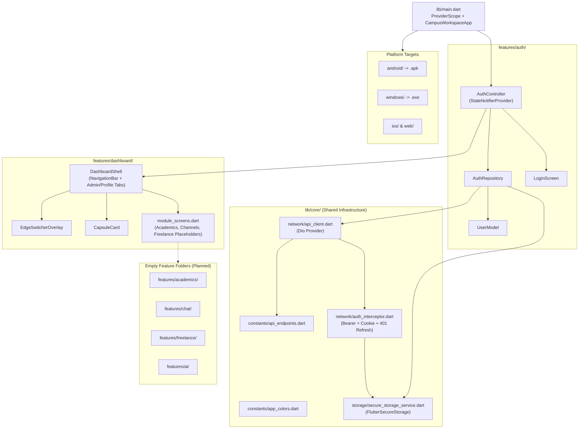

# Campus Mobile & Desktop (`campus_mobile`)

> Native **Android (`.apk`)** and **Windows Desktop (`.exe`)** Flutter client for **Northstar Campus**, backed by `campus-api`.

---

## 1. Tech Stack & Capabilities

- **Framework:** Flutter (`sdk: ^3.13.7`)
- **State Management:** `flutter_riverpod` (`StateNotifierProvider` + `Provider`)
- **Networking:** `dio` with `AuthInterceptor` (`QueuedInterceptor` for Bearer injection, cookie capture, and automatic `401` token refresh)
- **Secure Storage:** `flutter_secure_storage` (Android `encryptedSharedPreferences`, iOS Keychain, Windows Credential Manager)
- **Real-Time & Media:** `socket_io_client`, `livekit_client`
- **UI & Assets:** `google_fonts` (Inter), `flutter_svg`, `image_picker`, Material 3

---

## 2. Architecture Overview



---

## 3. Source Structure

- [lib/main.dart](lib/main.dart) — `ProviderScope` bootstrap and `CampusWorkspaceApp` auth router
- `lib/core/`
  - `constants/` — [api_endpoints.dart](lib/core/constants/api_endpoints.dart), [app_colors.dart](lib/core/constants/app_colors.dart)
  - `network/` — [api_client.dart](lib/core/network/api_client.dart), [auth_interceptor.dart](lib/core/network/auth_interceptor.dart)
  - `storage/` — [secure_storage_service.dart](lib/core/storage/secure_storage_service.dart)
- `lib/features/`
  - `auth/` — [user_model.dart](lib/features/auth/data/models/user_model.dart), [auth_repository.dart](lib/features/auth/data/auth_repository.dart), [auth_controller.dart](lib/features/auth/presentation/controllers/auth_controller.dart), [login_screen.dart](lib/features/auth/presentation/screens/login_screen.dart)
  - `dashboard/` — [dashboard_shell.dart](lib/features/dashboard/presentation/screens/dashboard_shell.dart), [module_screens.dart](lib/features/dashboard/presentation/screens/module_screens.dart), [capsule_card.dart](lib/features/dashboard/presentation/widgets/capsule_card.dart), [edge_switcher_overlay.dart](lib/features/dashboard/presentation/widgets/edge_switcher_overlay.dart)
  - `academics/`, `ai/`, `chat/`, `freelance/` — Reserved feature directories

---

## 4. Development & Release Builds

```powershell
# Install packages & run static checks
flutter pub get
flutter analyze
flutter test

# Run locally
flutter run -d windows
flutter run -d android

# Build Android APK -> build/app/outputs/flutter-apk/app-release.apk
flutter build apk --release

# Build Windows EXE -> build/windows/x64/runner/Release/campus_mobile.exe
# Note: Distribute the entire Release/ directory (EXE + DLLs + data/)
flutter build windows --release
```
